# Bloomfolio

DSE market research and simulated stock trading, with investor and admin portals. Built with React, Express, MongoDB, and a FastAPI market-data service.

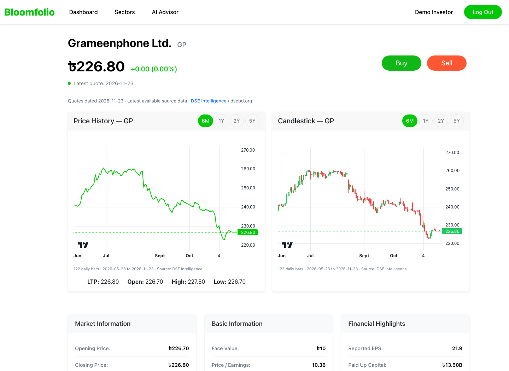

## Working features

| Feature | Functionality |
| --- | --- |
| Market dashboard | 400+ source-backed company quotes; search, sorting, pagination, trade/volume/value totals, and market breadth. |
| Stock research | Current available price, daily/52-week ranges, company facts, valuation, earnings, ownership charts, and dividend records. |
| Price charts | Visible line and candlestick charts, with 6M/1Y/2Y/5Y controls, crosshair, date/price axes, and actual coverage dates. |
| Sector browser | Expand sectors and compare/filter their stocks. |
| Investor account | Signup/login, virtual purchase power, holdings, cost/valuation, gain/loss, and executed transaction history. |
| Virtual trading | BUY/SELL order book, exact-price matching across different users, partial fills, balance/holding checks, pending orders, editing/resubmission, and cancellation. |
| Funding requests | Submit virtual-funding references; admins approve, reject, or modify the amount. A settled request cannot be credited again. |
| AI advisor | Select companies, ask questions grounded in their stored quotes, receive a generated reply, and reopen saved conversations. Supports local Ollama or Gemini. |
| Admin | Dashboard, user search, holding assignment at the stored market price, request review, and bulk quote synchronization with progress and working Stop control. |

**Trades, holdings, and funding are virtual.** This project does not route orders to DSE or process payments.

## Market data

FastAPI now connects to the public **[DSE Intelligence / StockChartBD data service](https://www.stockchartbd.com/developers.php)**, which republishes data sourced from **[dsebd.org](https://www.dsebd.org/)**. The original DSE scraping URLs no longer worked from this environment; the investor and admin APIs now share the working FastAPI adapter.

- The dashboard loads company quotes and fundamentals automatically, including on a fresh database. Admin synchronization persists all available snapshots to MongoDB.
- Company research adds source-backed company facts, ownership, annual/interim earnings, and dividends on demand.
- Charts use actual daily OHLCV records. No chart prices are generated, interpolated, or supplied by screenshot mocks.
- Quote dates and chart coverage are visible. These are the latest available source records, not a licensed exchange tick feed. A 5Y selection shows all records available within that period; the provider currently has about two years of history.
- Successful responses are cached on disk. Quotes refresh after 5 minutes, history after 1 hour, financials after 6 hours, and company facts after 24 hours. Source failures reuse successful saved responses with a **saved/stale** indicator.
- The adapter limits itself to 100 outgoing requests per hour, below the publisher's documented 120/hour allowance. Repeated chart requests share cached data.
- Missing source fields remain unavailable; a missing company never displays another company's sample.

Verified on **23 November 2026**: 412 company quotes, real GP history in all four range selections, ownership/dividend/financial records, functional virtual-trading and admin workflows, and a generated local-model advisor response. The screenshots use real market records plus fictional demo accounts and virtual balances.

## Repository

```text
apps/web/                    Investor React portal (5173)
apps/admin/                  Admin React portal (5174)
services/api/                User, portfolio, trading, funding, AI API (8080)
services/admin-api/          Admin API and quote synchronization (8081)
services/market-data/        FastAPI provider adapter, cache, history (8000)
scripts/                     Setup, runner, fixture seed, checks and captures
docs/screenshots/            Verified feature screenshots
.github/workflows/           Frontend build and market-data unit tests
```

See [architecture and data flow](docs/architecture.md).

## Setup and run

Requires Node **22.12+**, Python **3.10+**, npm, and a running MongoDB server. The commands below target macOS/Linux.

```sh
git clone https://github.com/RezuanMustafaHasan/Bloomfolio.git
cd Bloomfolio
npm ci
npm run setup
npm run dev
```

`setup` installs each Node project from its lockfile, creates the Python virtual environment, and creates missing `.env` files with separate random JWT secrets. Existing configurations are preserved. Both APIs must use the same `MONGODB_URI`; the default is `mongodb://127.0.0.1:27017/bloomfolio`.

| Component | URL |
| --- | --- |
| Investor portal | http://localhost:5173 |
| Admin portal | http://localhost:5174 |
| User API health | http://localhost:8080/api/health |
| Admin API health | http://localhost:8081/api/health |
| Market-data health | http://localhost:8000/api/health |
| Interactive API docs | http://localhost:8000/docs |

Use `localhost` consistently in the browser. Ctrl+C stops all five processes. Each component also has a root `dev:web`, `dev:admin`, `dev:api`, or `dev:admin-api` command. To run FastAPI separately:

```sh
cd services/market-data
.venv/bin/python -m uvicorn main:app --host 127.0.0.1 --port 8000
```

### Local AI without an API key

Install and start [Ollama](https://ollama.com/), then download the small model used in local verification:

```sh
ollama pull qwen3:0.6b
```

Set these in `services/api/.env` and restart the stack:

```dotenv
AI_PROVIDER=ollama
OLLAMA_URL=http://127.0.0.1:11434
OLLAMA_MODEL=qwen3:0.6b
```

Alternatively use `AI_PROVIDER=gemini` with a valid `GEMINI_API_KEY` and `GEMINI_MODEL`. Requests have bounded timeouts and expose actionable provider errors; they do not silently substitute fabricated answers. The advisor is experimental and generated text can be wrong.

### Demo and feature verification

With the stack running, create the isolated demo accounts and source-backed snapshots:

```sh
npm run seed:demo
```

Stop the stack, then restart against the same demo database:

```sh
MONGODB_URI=mongodb://127.0.0.1:27017/bloomfolio_demo npm run dev
```

The seed adds real market snapshots, fictional investor/counterparty/admin accounts, and virtual balances/holdings. Generated credentials are stored only in **`.runtime/demo-credentials.json`** and are excluded from Git. The normal `bloomfolio` database is untouched. Existing demo accounts and their version-2 portfolios are preserved on repeat seeds.

Then, in another terminal:

```sh
npm run test:features
```

This performs actual API operations in the demo database: authentication checks, funding submission/approval/rejection/modification, duplicate-approval prevention, a matched virtual trade, order editing/cancellation, holding assignment, bulk-sync stop/completion, and a generated/saved advisor reply. It leaves useful pending orders, funding requests, and transaction history for feature captures. It requires the running demo stack and a configured AI model.

For a normal account, use `/signup`. Bootstrap your local admin through `POST http://localhost:8081/admin/auth/signup` with `name`, `email`, and `password`; then log in at `/admin/login`.

### Configuration

| Location | Settings |
| --- | --- |
| `apps/web/.env` | `VITE_BACKEND_BASE`, `VITE_MARKET_DATA_BASE` |
| `apps/admin/.env` | `VITE_ADMIN_BACKEND_BASE` |
| `services/api/.env` | `PORT`, `MONGODB_URI`, `JWT_SECRET`, `FRONTEND_ORIGIN`, `MARKET_DATA_URL`, AI provider/model settings |
| `services/admin-api/.env` | `ADMIN_PORT`, `MONGODB_URI`, `ADMIN_JWT_SECRET`, `ADMIN_FRONTEND_ORIGIN`, `MARKET_DATA_URL` |
| FastAPI process environment | Optional `FRONTEND_ORIGINS` and `MARKET_CACHE_DIR` |

Copy the supplied `.env.example` files when configuring manually. Restart Vite after changing `VITE_*` values. API keys belong in server configuration, never in a `VITE_*` variable.

## Feature screenshots

All images are captured from functional screens, after API workflow checks. Public market records are real; users, holdings, pending orders, and funding requests are part of the local simulation. The screenshot runner checks both bar counts **and visible colored plot pixels**, changes chart ranges, tests another symbol, and uses the visible login forms.

### Dashboard and sectors


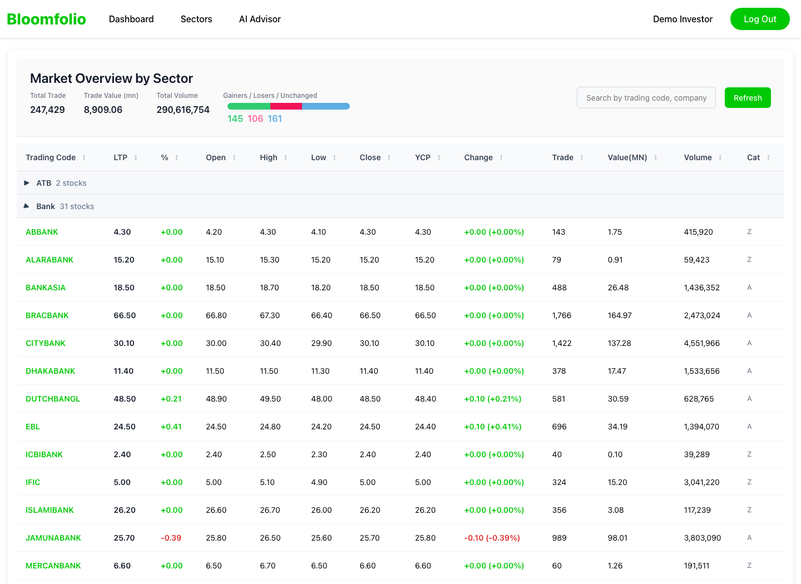

### Company research

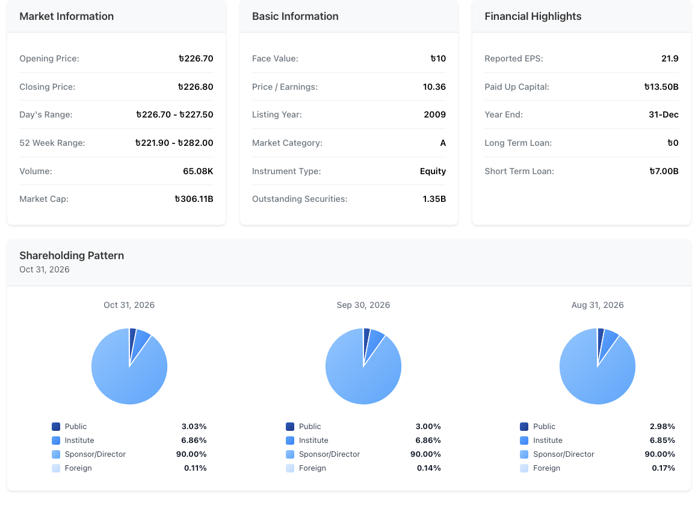
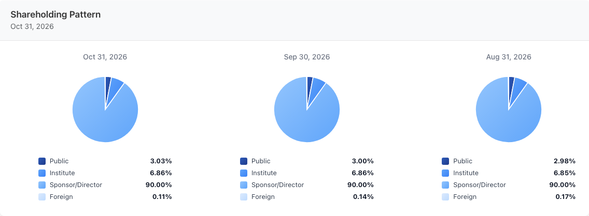
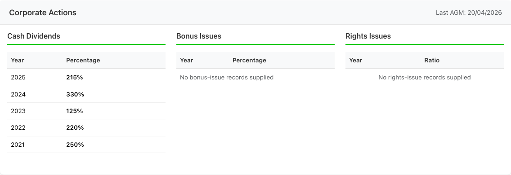
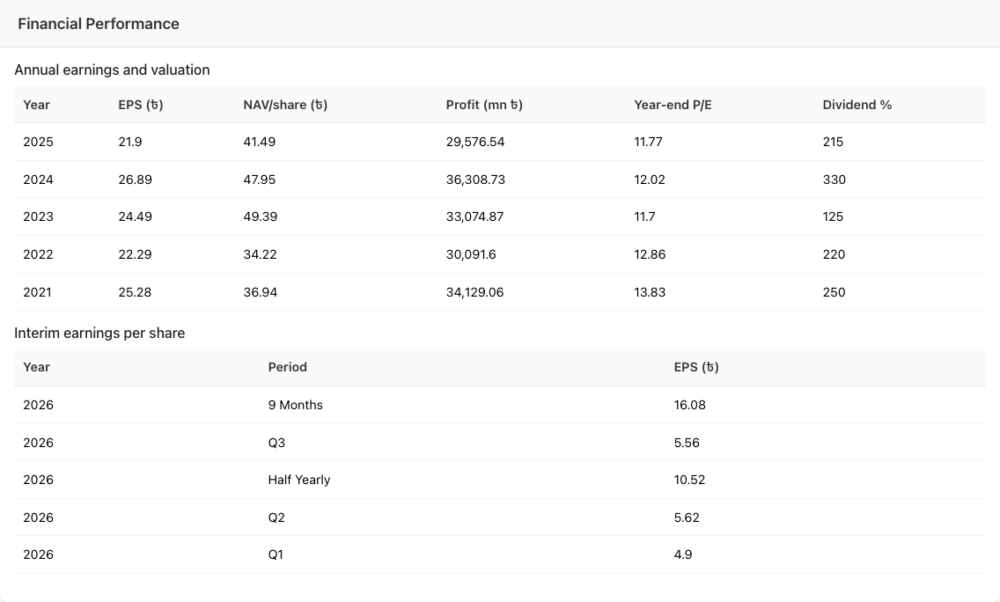

### Trading and portfolio


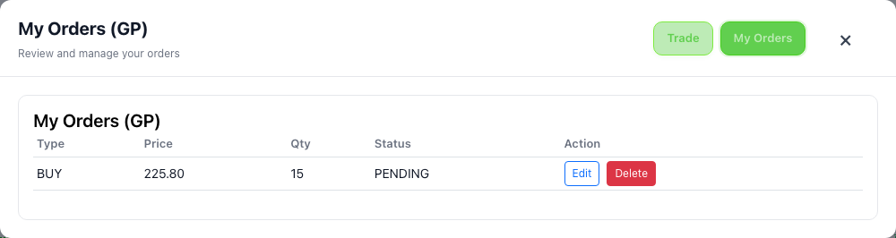
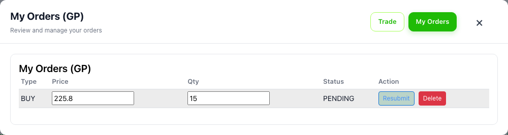

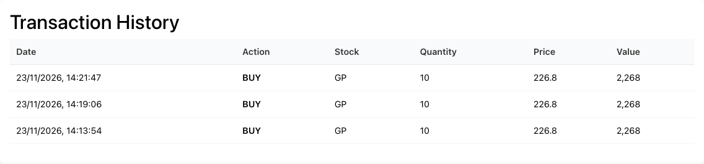


### Generated advisor conversation

This shows an actual locally generated response and saved conversation, not a prewritten example answer.


### Administration

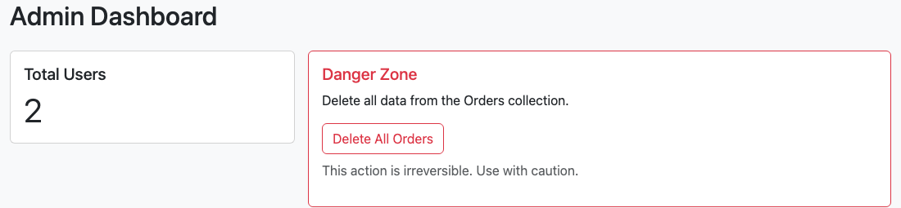
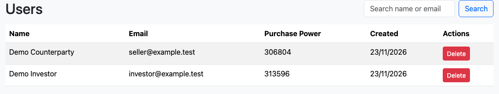
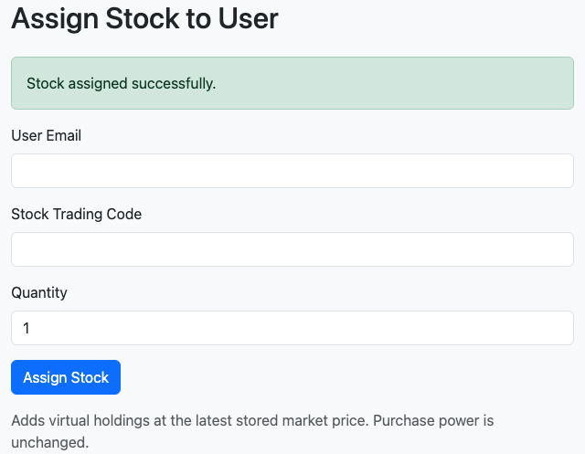

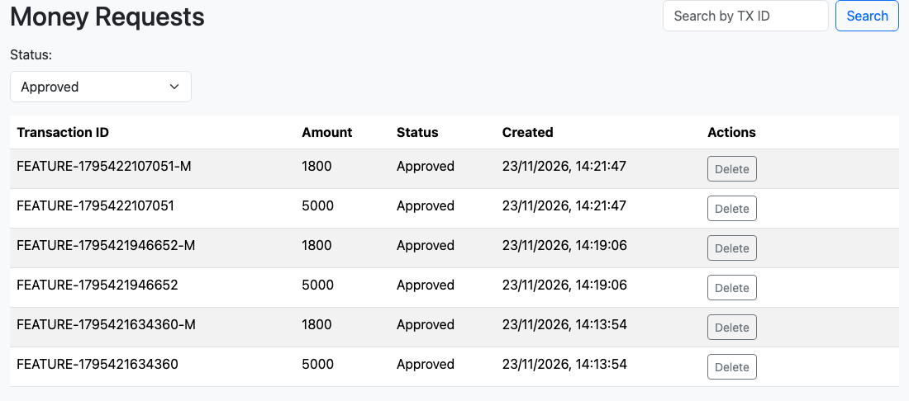
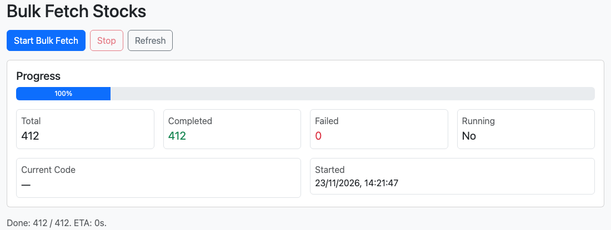

<details>
<summary>Authentication and API documentation</summary>

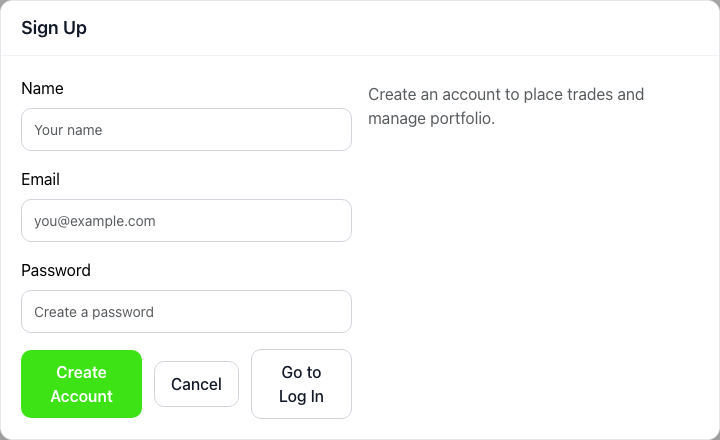
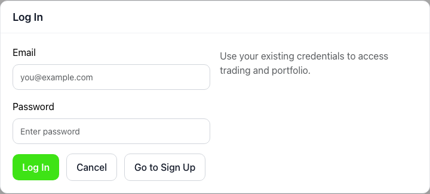
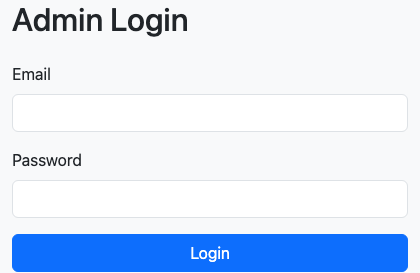
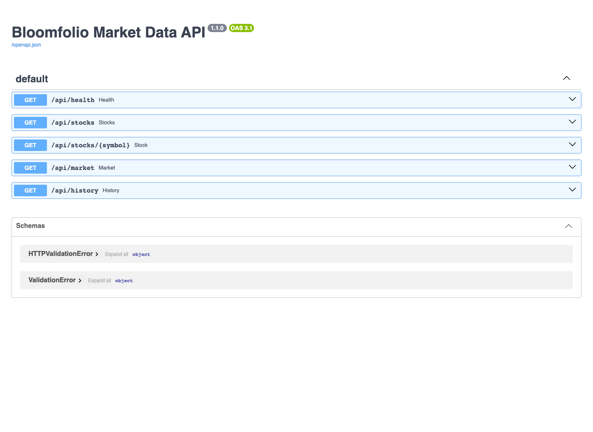

</details>

## Checks and screenshot refresh

```sh
npm run build                 # Both production frontend builds
npm run test:market-data      # Normalization, parsing, caching, stale fallback, errors
npm run check                 # Read-only checks against the running stack
npm run test:features         # Demo-only workflow mutations and AI generation
npx playwright install chromium
npm run screenshots           # Requires successful feature-evidence file
```

CI builds the frontends and runs unit tests without a network source or database. The local workflow tests establish source and integration behavior; unit-test fixtures are never used as app market data.

## Current boundaries

- Market records can be delayed or stale. Check their visible dates and independently verify anything used outside this simulator.
- Matching runs serially within one API process. Ledger updates are not distributed database transactions; multi-instance trading requires a transactional design.
- Admin bootstrap is an existing local-development endpoint. A public deployment needs admin provisioning and authentication hardening.
- Bonus/rights records not supplied by the source are labeled as unavailable. They are not inferred from cash dividends.
- Source-dependent feature checks need internet access; local AI needs Ollama running with the configured model.
- Existing Node audit findings and the investor bundle-size warning remain separate maintenance work.
