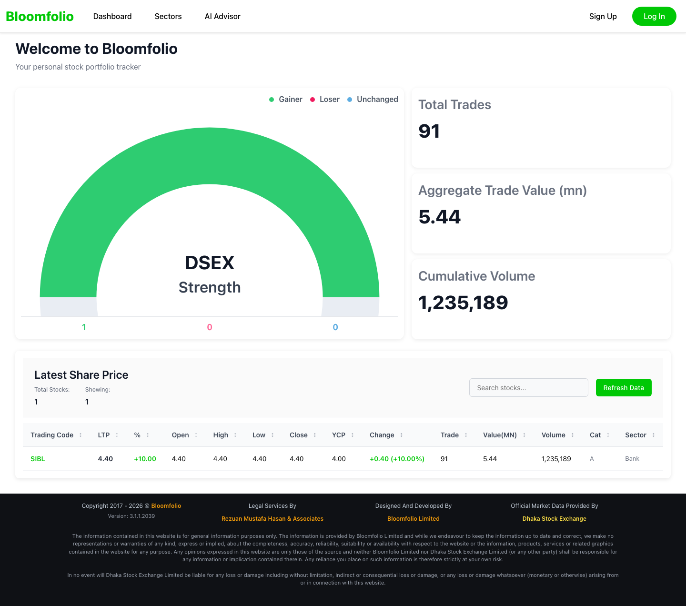
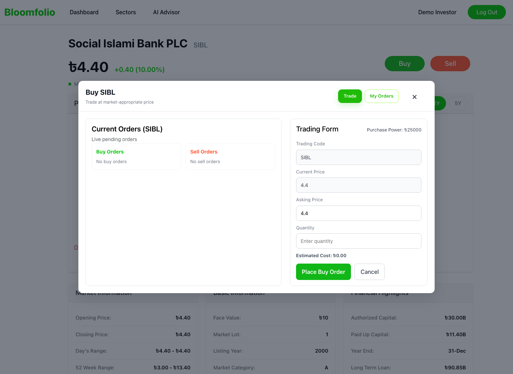
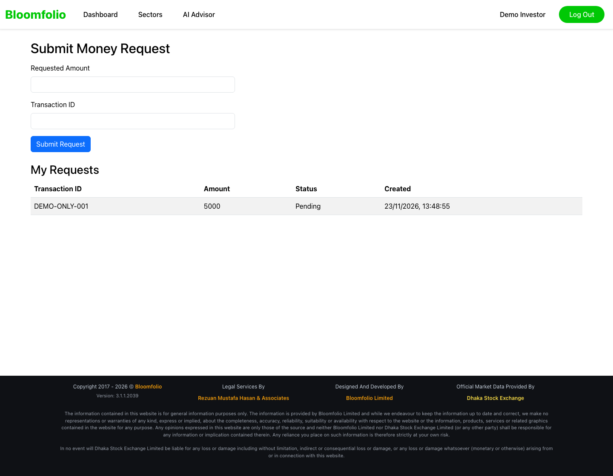
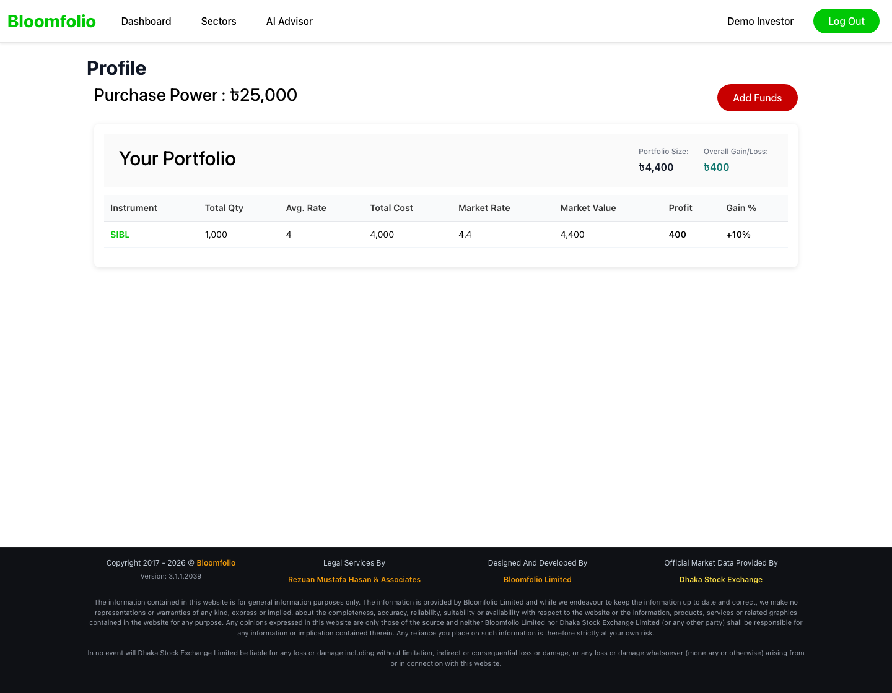
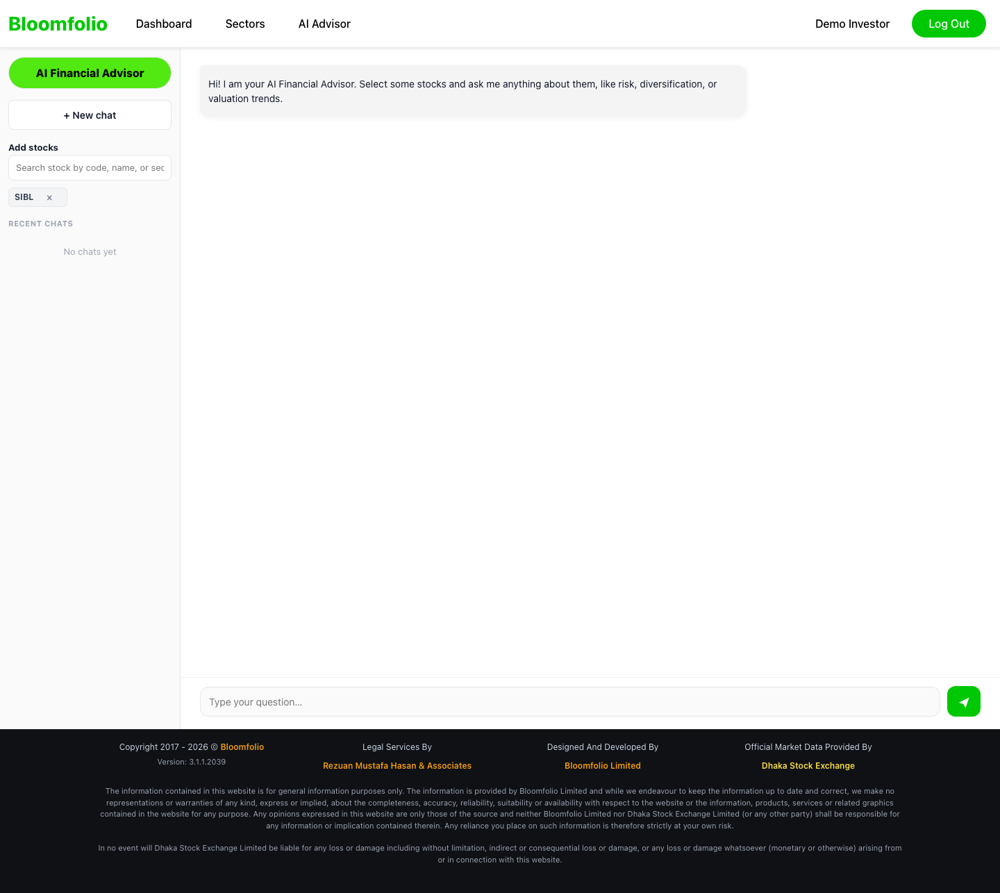
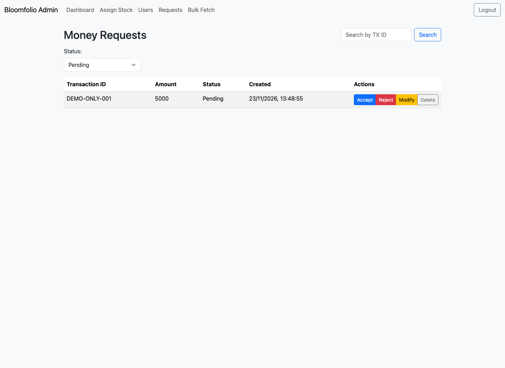

# Bloomfolio

A full-stack Dhaka Stock Exchange (DSE) research and **simulated stock trading** application. Browse company snapshots, compare sectors, inspect price history, manage a virtual portfolio, submit orders and funding requests, and administer the platform from a separate portal.

Built with React, Vite, Express, MongoDB, and FastAPI. Trades and balances are recorded inside Bloomfolio; there is no brokerage connection, exchange order routing, or real payment processing.



## Features

| Area | What it does |
| --- | --- |
| Market dashboard | Search, sort, and paginate stored stocks; view aggregate trade count, value, volume, and gainers/losers/unchanged counts. |
| Company research | View market prices and ranges, company fundamentals, ownership, corporate actions, EPS, and financial highlights where source data is available. |
| Historical charts | Line and candlestick charts with 6M, 1Y, 2Y, and 5Y ranges, served by the FastAPI history endpoint. |
| Sector browser | Expand sectors, search companies, and compare stored stock metrics. |
| Account and portfolio | Sign up/log in, inspect purchase power, holdings, valuation, profit/loss, pending orders, and transaction history. |
| Simulated order book | Submit BUY/SELL orders, inspect the book, resubmit/cancel owned orders, and request matching against opposite orders at the same price. |
| Funding requests | Submit an amount and transaction reference; track request status. Admin approval adjusts virtual purchase power. |
| AI financial advisor | Select companies, ask Gemini questions using stored company context, and revisit saved chat sessions. Requires a Gemini API key. |
| Admin portal | Log in separately, search/manage users, assign holdings, review funding requests, and run/monitor a bulk company-data scrape. |

## Data sources and freshness

Bloomfolio has **two different market-data paths**:

1. **Company snapshots:** the admin Express service scrapes DSE company pages and writes documents to MongoDB. The user API reads those stored documents. Starting the app does not automatically refresh the database. The price panel polls the stored snapshot every 30 seconds; that polling is not an exchange live feed.
2. **Daily chart history:** the FastAPI service requests DSE's day-end archive on demand and returns daily OHLCV rows. These are daily bars, not intraday ticks.

The dashboard's “DSEX Strength” gauge summarizes the loaded stocks; it does not calculate the official DSEX index.

**Verified on 23 November 2026:** the apps and APIs run locally. DSE requests returned HTTP 403/410 from this environment, so fresh company scraping and historical bars could not be verified end to end. Charts display the upstream-unavailable message when DSE cannot be reached. Screenshots below use the bundled October 2025 SIBL sample and fictional local accounts; they do not show current market quotes or a generated AI answer.

## Repository layout

```text
Bloomfolio/
├── apps/
│   ├── web/                 # React investor portal (5173)
│   └── admin/               # React admin portal (5174)
├── services/
│   ├── api/                 # Express user, portfolio, order, funding, AI API (8080)
│   ├── admin-api/           # Express admin API and DSE company scraper (8081)
│   └── market-data/         # FastAPI daily OHLCV history API (8000)
│       └── tests/           # Parser and upstream-error tests
├── scripts/                 # Setup, process runner, demo seed, checks, screenshots
├── docs/
│   ├── architecture.md      # Data flow, service responsibilities, migration map
│   └── screenshots/         # Captures of the actual local application
└── .github/workflows/       # Frontend builds and market-data tests
```

The former `user/frontend`, `user/backend`, `admin/admin-frontend`, and `admin/admin-backend` folders have moved to the locations above. The previously external FastAPI chart service is now included in this repository. Each Node app/service retains its own lockfile.

## Run locally

### Requirements

- Node.js **22.12+** and npm (`.nvmrc` selects Node 22).
- Python **3.10+** with `venv` and pip; verified with Python 3.14 locally.
- MongoDB running locally, or a MongoDB URI you control.
- Internet access for dependency installation and DSE requests. A Gemini key is optional.

The commands below target macOS/Linux.

```sh
git clone https://github.com/RezuanMustafaHasan/Bloomfolio.git
cd Bloomfolio
npm ci
npm run setup
```

`setup` installs the four Node projects using their lockfiles, creates the Python virtual environment, installs the market-data dependencies, and creates missing `.env` files from the examples. New API configurations receive separate random JWT secrets. Existing `.env` files are preserved.

Check `services/api/.env` and `services/admin-api/.env`: both must use the same `MONGODB_URI`. By default they use `mongodb://127.0.0.1:27017/bloomfolio`.

With MongoDB running:

```sh
npm run dev
```

This starts all five processes. Press **Ctrl+C** to stop the group; if one service fails, the runner stops the remaining services so startup failures are visible.

| Component | Local URL |
| --- | --- |
| Investor portal | http://localhost:5173 |
| Admin portal | http://localhost:5174 |
| User API health | http://localhost:8080/api/health |
| Admin API health | http://localhost:8081/api/health |
| Market-data API health | http://localhost:8000/api/health |
| FastAPI interactive docs | http://localhost:8000/docs |

Use `localhost` consistently for the browser and APIs so cookies work across these ports.

### Try the isolated sample

The demo seed uses a separate local database, `bloomfolio_demo`. It adds the existing SIBL sample, a fictional investor with holdings and virtual balance, an admin, and one funding request. It does not erase collections or modify the normal `bloomfolio` database.

Stop any running Bloomfolio stack, then:

```sh
npm run seed:demo
MONGODB_URI=mongodb://127.0.0.1:27017/bloomfolio_demo npm run dev
```

Generated login details are saved locally in **`.runtime/demo-credentials.json`**, which is excluded from Git. Open `/login` in the investor portal or `/admin/login` in the admin portal. The seed leaves existing demo accounts untouched; keep the generated credentials file.

For normal use, create an investor through `/signup`. The admin portal has a login page; the existing admin bootstrap endpoint is `POST http://localhost:8081/admin/auth/signup` with `name`, `email`, and `password`. Create an admin only in your own local deployment.

To populate a fresh normal database, sign in as admin, open **Bulk Fetch**, and start the scrape. It processes configured trading codes in batches and shows progress/errors. DSE must be reachable for this to succeed.

### Configuration

| File | Variables |
| --- | --- |
| `apps/web/.env` | `VITE_BACKEND_BASE` (default `http://localhost:8080`), `VITE_MARKET_DATA_BASE` (default `http://localhost:8000`) |
| `apps/admin/.env` | `VITE_ADMIN_BACKEND_BASE` (default `http://localhost:8081`) |
| `services/api/.env` | `PORT`, `MONGODB_URI`, `JWT_SECRET`, `FRONTEND_ORIGIN`; optional `GEMINI_API_KEY`, `GEMINI_MODEL` |
| `services/admin-api/.env` | `ADMIN_PORT`, `MONGODB_URI`, `ADMIN_JWT_SECRET`, `ADMIN_FRONTEND_ORIGIN` |
| Market-data process environment | Optional `FRONTEND_ORIGINS`, a comma-separated list; defaults to the two local portals. |

Restart Vite after changing `VITE_*` settings. If you change a backend port, update the corresponding frontend URL. The root runner uses port 8000 for FastAPI; run it separately to choose another port. Never put API keys in `VITE_*` variables because those values are shipped to the browser.

Individual commands:

```sh
npm run dev:web
npm run dev:admin
npm run dev:api
npm run dev:admin-api
# In a separate terminal, from the repository root:
cd services/market-data
.venv/bin/python -m uvicorn main:app --host 127.0.0.1 --port 8000
```

## Feature screenshots

Captured from the running application at 1440 px width with the isolated sample database. Portfolio balances, the funding reference, and account identities are fictional. Chart panels show the actual DSE access failure. The AI screenshot shows the interface; model generation requires your own configured key.

### Stock research and history panels

Company prices, fundamentals, financial data, corporate actions, and chart range controls. The visible chart error documents the upstream restriction during capture.


### Simulated trading and order book

Inspect pending BUY/SELL orders and prepare an order with price and quantity. No order was submitted during capture.



### Funding requests

Submit a virtual-funding request and inspect its status.



### Portfolio

Holdings, average cost, current stored valuation, purchase power, and profit/loss.



### Sector comparison

Expand a sector to see its company table and compare metrics.


### AI advisor

Select stocks, compose questions, and access saved conversations.



### Admin funding review

Filter requests by status or transaction reference; accept, reject, or modify requests.



### Admin bulk data collection

Start company-data collection and inspect progress and failures.


### FastAPI documentation

Inspect and try the health and daily-history endpoints.


## API overview

| Service | Route | Purpose |
| --- | --- | --- |
| User | `GET /fetch-all-stocks`, `GET /fetch-details/:code` | Read MongoDB company snapshots. |
| User | `POST /signup`, `POST /login` | Cookie-based user sessions. |
| User | `GET /users/:id`, `GET /users/:id/portfolio/:code` | Authenticated profile access and own-stock holdings. |
| User | `/api/orders`, `/api/orders/mine`, `/api/orders/:id/resubmit` | Order listing, creation, resubmission, and cancellation. Writes/own orders require a session. |
| User | `POST /api/order/execute/:orderId` | Request internal matching at the same asking price. |
| User | `POST /api/requests`, `GET /api/requests/mine` | Own virtual-funding requests. |
| User | `/api/ai/chat`, `/api/ai/sessions`, `/api/ai/session/:id` | Gemini chat and saved conversations. |
| Admin | `/admin/auth/*`, `/admin/users`, `/admin/assign-stock` | Admin sessions and user/holding administration. |
| Admin | `/admin/requests/*`, `/admin/bulk-fetch*` | Funding review and company-data collection. |
| Market data | `GET /api/history?symbol=CITYBANK&months=6` | Daily history; months must be 1–120. |

History response fields are `symbol`, `start`, `end`, `count`, and `data`; each row contains `date`, `open`, `high`, `low`, `close`, and `volume`. Rows are sorted by date and deduplicated. The service returns 422 for invalid queries, 404 for an empty archive table, 502 for upstream HTTP/markup failures, and 504 for timeouts. Health checks confirm the service is running; they do not verify DSE availability.

## Verification and screenshot refresh

```sh
npm run build                 # Production builds of both React apps
npm run test:market-data      # Parser, response contract, and error handling
npm run check                 # Read-only smoke checks; requires npm run dev
```

CI builds both portals and runs the market-data tests without relying on DSE or a database. Unit fixtures exercise the parser and errors; they do not establish live-source availability.

To refresh screenshots, run the isolated sample stack as above, then in another terminal:

```sh
npx playwright install chromium
npm run screenshots
```

The capture script logs into the generated demo accounts, verifies stock filtering, captures all documented screens, and fails on uncaught browser errors. It does not mock market responses, invoke Gemini, start a scrape, or execute trades. Only run it against the demo stack because it overwrites the documentation images.

## Troubleshooting and current limits

- **Empty stock table:** a fresh database has no snapshots. Run the admin scrape or use the isolated sample. Missing stock details show an unavailable message instead of another company's sample data.
- **DSE 403 / unavailable history:** the source may restrict access from your network. FastAPI now bounds requests to 20 seconds and reports upstream failures. Existing MongoDB snapshots remain available. No successful live-history capture is claimed here.
- **MongoDB connection failure:** start MongoDB and check both API environment files. Use the same URI for both services.
- **Port already in use:** stop the previous stack. Vite uses strict ports 5173/5174 and will fail rather than silently move to a port outside the configured origins.
- **AI missing-key/quota/model error:** configure `GEMINI_API_KEY` in the user API and restart. Stored company context may be stale; the advisor is an experimental feature.
- **Prototype boundaries:** admin registration is exposed through the existing API; cookie authentication, authorization, and order matching need a separate production review. Trade updates are not wrapped in a database transaction. The bulk-fetch stop flag does not currently cancel already scheduled work. Use this as a local simulation.
- **Dependency/build debt:** existing Node dependencies have audit findings, and the investor bundle triggers Vite's size warning. Dependency upgrades and bundle splitting are separate follow-up work.

See [architecture and migration notes](docs/architecture.md) for service boundaries and data flow.
