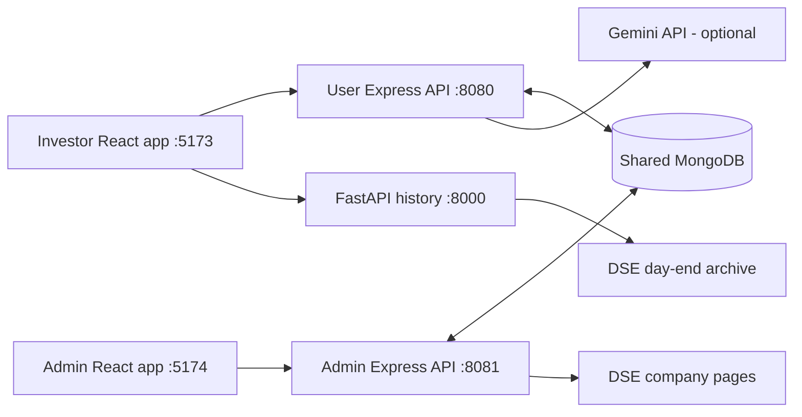

# Architecture and migration notes

## Runtime data flow

The user and admin APIs share a database. Models remain inside each service to preserve the existing implementation; they have not been unified into a shared package. The user Stock schema is detailed, while the admin Stock schema accepts scraped fields. Keep these compatible when changing persistence.

## Service responsibilities

- `apps/web`: investor routes, authenticated account controls, stock research, charts, funding requests, and AI chat.
- `apps/admin`: admin login, user search, stock assignment, request review, and bulk-fetch controls.
- `services/api`: user authentication, profile data, stored market snapshots, order book/matching, funding submissions, and Gemini sessions.
- `services/admin-api`: admin authentication, user administration, virtual funding approval, holding assignment, and DSE scraping.
- `services/market-data`: stateless daily-history requests and OHLCV normalization. It does not read/write MongoDB.

## What changed in this reorganization

| Previous location | New location |
| --- | --- |
| `user/frontend/` | `apps/web/` |
| `admin/admin-frontend/` | `apps/admin/` |
| `user/backend/` | `services/api/` |
| `admin/admin-backend/` | `services/admin-api/` |
| External local `GPT 5/DSE/dse-api/` | `services/market-data/` |

The unused `user/package.json` and its lockfile were removed. Application dependencies and their lockfiles remain with their owning service/app. Frontends now read API origins from central configuration modules and `.env.example` files. The user API defaults to port 8080, matching its clients. Both Vite servers use explicit, strict local ports.

The original FastAPI service called `bdshare`, whose installed version pointed to `dsebd.com.bd`; that hostname did not resolve during verification. The included service requests the official DSE archive directly, using the same daily table columns. It retains the `/api/history` contract, adds input validation, rejects malformed/non-finite data, deduplicates dates, and reports upstream errors explicitly. The original broad exception handler turned empty-history 404s into 500s; the new service preserves the intended status.

Stock detail screens no longer initialize from the unrelated bundled SIBL sample. They show loading/error state until the requested stock exists. The sample remains an explicit fixture for `seed:demo` only.

## Order and funding behavior

Order matching is internal and initiated by the execution endpoint. It searches opposite-side orders at the exact asking price in creation/serial order and adjusts virtual balances, holdings, and transaction history. This is not an exchange matching engine. Existing matching limitations, such as non-transactional writes and concurrency behavior, have not been redesigned in this repository cleanup.

Funding requests store a transaction reference and amount for admin review. Approval changes the user's virtual purchase power; no payment provider verifies or settles the reference.

The bulk scraper works through a configured trading-code list in batches. Its progress state is process-local and is lost on restart. The existing stop control sets a flag but the batch loop does not yet honor that flag as cancellation.

## Verification scope

Local validation includes setup, both frontend production builds, three API health checks, frontend HTTP responses, query validation, parser/error unit tests, rendered pages, stock search, and user/admin logins. Documentation captures use a separate `bloomfolio_demo` database and fictional accounts. No real trades or funding actions were performed.

DSE requests returned HTTP 403/410 on 23 November 2026. Live history and fresh bulk scraping therefore remain unverified. The AI screen was captured without calling Gemini. Existing security and dependency issues are recorded in the root README rather than represented as fixed by this restructuring.
