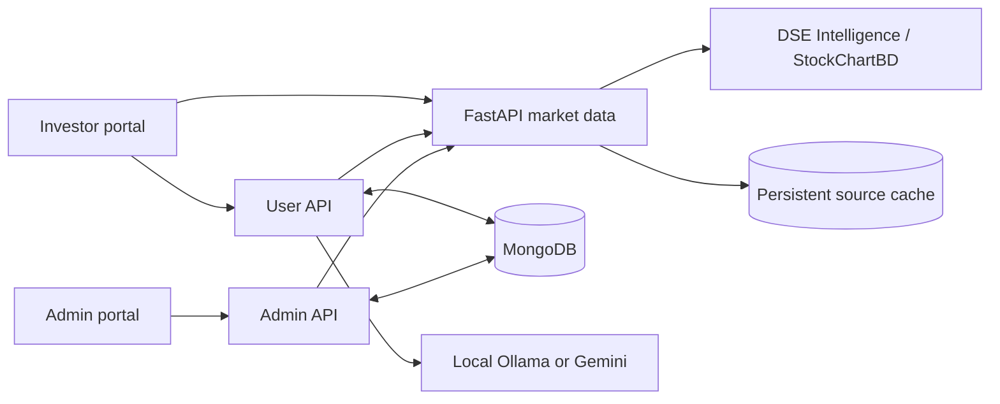

# Architecture

The FastAPI adapter is the shared market-data boundary. It fetches quotes and fundamentals for the dashboard, daily OHLCV history for charts, and detailed company facts/ownership/earnings/dividends for research. Source attribution is DSE Intelligence, with dsebd.org credited as the underlying source. See the [publisher's data documentation](https://www.stockchartbd.com/developers.php).

`provider.py` validates and normalizes source fields, deduplicates/sorts daily bars, rejects malformed candles, bounds HTTP requests, caches successful responses to disk, caps upstream request volume, and marks saved responses stale when a refresh fails. Financial data is not fabricated for absent fields. Price history is filtered to the requested range; availability dates expose the source's actual coverage.

The user API automatically reads FastAPI snapshots and persists them to MongoDB. Detailed research is loaded on demand. If the market-data service is unavailable, previously persisted documents can be returned with a stale marker. Snapshot updates use nested field paths so they preserve detailed company fields.

The admin bulk job synchronizes all available quotes through the same adapter instead of scraping broken DSE company URLs. It yields between records, honors cancellation, and persists its most recent progress. An interrupted process does not resume a job automatically.

Trades are a local simulation: order execution requires ownership, ignores the initiating user's opposite orders, matches exact prices in FIFO order, checks funds and holdings, and records both participants' transaction history. Processing traverses candidate orders once and runs through a single-process queue. It cannot spin forever on an unfillable order. Multi-process transaction guarantees remain outside this prototype.

Funding settlement atomically claims a pending request before applying credit. Settled requests return 409 on repeated acceptance. Admin holding assignment validates the symbol and uses its stored current price as the initial virtual cost.

The advisor accepts a bounded question and up to five stock contexts, uses a configured model with a timeout, and saves the generated exchange under the authenticated user. Local verification uses Ollama `qwen3:0.6b`. Provider errors remain errors; no canned answer is substituted.

The feature-check script operates only with explicitly generated fictional demo accounts. It exercises real HTTP routes and the virtual ledger, then writes a gitignored evidence file. Screenshots require that evidence and validate actual canvas plot pixels and non-empty source history, along with range/symbol navigation and populated workflow screens.

The repository paths are `apps/web`, `apps/admin`, `services/api`, `services/admin-api`, and `services/market-data`. Existing Node project lockfiles stay with their owning applications/services.
